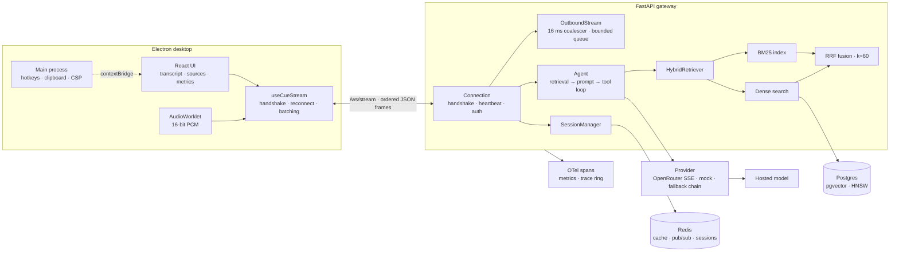
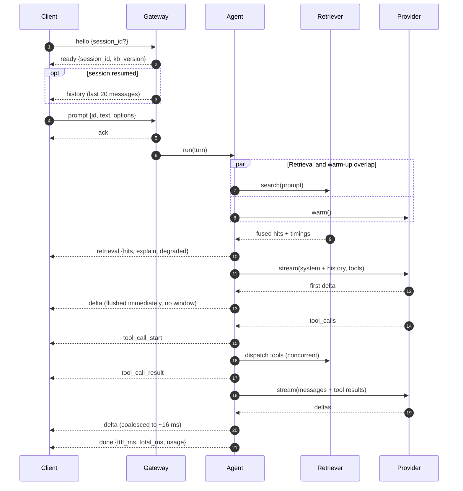

# cuePilot

[](https://github.com/Mahnoor-Zaffar/CuePilot-Real-Time-Hybrid-Autonomous-Assistant/actions/workflows/ci.yml)


A real-time desktop copilot that streams grounded answers over a single full-duplex
WebSocket. Electron/React client, FastAPI gateway, hybrid **BM25 + pgvector** retrieval,
streamed tool calling, and first-class handling of backpressure, cancellation, reconnect,
and infrastructure loss.

The thesis: real-time AI is a **transport and retrieval problem** before it is a prompt
problem. Tokens arrive out of order or not at all, clients are slower than models, providers
rate-limit, caches go stale, and a socket dies mid-sentence. This repo treats those as the
product, not as edge cases.

```
64 tests · ruff clean · tsc clean · renderer 245 KiB / 76 KiB gzip
```

---

## At a glance

| | |
|---|---|
| **Transport** | One ordered `/ws/stream` socket carrying typed JSON frames, both directions |
| **Retrieval** | Parallel BM25 and dense search fused with reciprocal rank fusion (`k=60`) |
| **Generation** | OpenRouter (OpenAI-compatible SSE) with a deterministic offline mock |
| **Tool loop** | `kb_search`, `kb_open`, `now`, `kb_stats`; validated schemas, bounded iterations |
| **Backpressure** | Server coalesces to ~16 ms frames and drops frames, never text; client batches per animation frame |
| **State** | Sessions hot in memory, mirrored to Redis; `kb_version` invalidates retrieval caches |
| **Observability** | OTel spans plus an in-process trace ring at `/api/traces/{id}`; latency histograms at `/api/metrics` |
| **Runs offline** | No API key, no Docker, no model download required |

---

## Architecture



Everything is built once in the FastAPI lifespan and stored on `app.state.runtime`.
The WebSocket handler and REST routes share the same graph; nothing constructs clients
per request.

---

## A turn, end to end



Ordering is a transport guarantee, not a merge algorithm:

```
ack → retrieval? → (delta | tool_call_start | tool_call_result)* → done | aborted | error
```

The server flushes buffered text before any control or terminal frame. The client flushes
pending text before applying `done`/`error`/`aborted`/`history`. Deltas carry a monotonic
`seq` per turn. See [docs/PROTOCOL.md](docs/PROTOCOL.md) for every frame and close code.

---

## What is actually hard here

| Problem | Mechanism | Where |
|---|---|---|
| A slow client must not corrupt the answer | Coalesce deltas into ~16 ms frames; on a full queue drop the **frame** and re-queue its text | `server/app/ws/outbound.py` |
| TTFT must not pay for batching | The first delta bypasses the flush window; the client paints it immediately | `outbound.py`, `useCueStream.ts` |
| A cancel must stop the upstream bill | Cancel the turn task; the provider's `async with` closes the SSE response | `agent.py`, `connection.py` |
| Abort may land on another replica | Publish `turn.abort` on Redis pub/sub; the owning replica cancels | `runtime.py`, `bus.py` |
| Ingest must invalidate every cached result | Cache key embeds `kb_version`; ingest publishes `kb.invalidate` | `orchestrator.py`, `api/kb.py` |
| One retriever can be down | `gather(return_exceptions=True)`; fuse the survivor and report `degraded` | `orchestrator.py` |
| A mid-stream retry would duplicate text | Retries and model fallback happen **only before the first token** | `openrouter.py`, `registry.py` |
| Postgres/Redis may not exist | In-process exact-cosine store and TTL cache/bus with identical interfaces | `infra/db.py`, `infra/cache.py`, `infra/bus.py` |

---

## Measured results

Generated by `server/bench/run_bench.py` on the machine in [docs/METRICS.md](docs/METRICS.md).
Every number is produced by running this code; none is hand-entered. Re-run with `make bench`.

| Metric | Result |
|---|---|
| Hybrid recall@5 — 32 labelled queries, 56 docs → 62 chunks | **90.0%** |
| BM25 / dense recall@5 | 86.7% / 83.3% |
| Hybrid vs. best single retriever | **+3.3 pp** |
| Paraphrase-query recall@5 | **81.2%** (BM25 75.0%, dense 68.8%) |
| Retrieval latency | p50 **1.46 ms**, p95 **1.95 ms** |
| Client-observed TTFT, mock provider with a fixed 120 ms first byte | p50 **~125 ms**, p95 **~131 ms** |
| Gateway overhead above the provider's first byte | p50 **~1.1 ms**, p95 **~1.2 ms** |
| Delta coalescing, 300 tokens @ ~90 tok/s | **151 frames** (−49.7%), lossless, 0 drops |
| Renderer JS heap, idle | **9.5 MB**, 137 DOM nodes |
| Renderer process working set, idle | **79.9 MB** |
| Renderer bundle | **245 KiB JS / 76 KiB gzip**, 18 KiB CSS / 4.3 KiB gzip |

### What these numbers do and do not say

- **TTFT is a gateway claim, not a model claim.** With a deterministic mock whose first byte
  is fixed at 120 ms, the client sees ~125 ms and the gateway adds ~1 ms. A hosted model's
  TTFT is provider-dependent; the defensible column is the overhead.
- **The hybrid target was +15–25%; this corpus measures +3.3 pp.** Recall is near its
  ceiling on 56 documents and BM25 already aces identifier queries, so there is little
  headroom. The gain is where it should be — paraphrase queries rose from 75.0% to 81.2%,
  and hybrid recovered two queries dense-only missed. The harness is ready for a larger,
  more adversarial corpus.
- **Memory is the renderer JS heap, not process RSS.** The sub-50 MB target is met by the
  9.5 MB heap. Chromium's renderer working set is 79.9 MB and all Electron processes total
  ~247 MB; that baseline belongs to the runtime, not the React tree.
- **Retrieval quality uses the offline hash embedder.** It measures lexical robustness, not
  semantics. Set `CUEPILOT_OPENAI_API_KEY` and re-run `make bench` for real embeddings; the
  harness and query set are unchanged.

---

## Quickstart

Requirements: Python 3.12, [uv](https://docs.astral.sh/uv/), Node 20+. Docker is optional.

```bash
git clone https://github.com/Mahnoor-Zaffar/CuePilot-Real-Time-Hybrid-Autonomous-Assistant.git
cd CuePilot-Real-Time-Hybrid-Autonomous-Assistant

make setup            # server/.venv + desktop/node_modules, creates .env
docker compose up -d  # pgvector on 5433, Redis on 6380 (optional)
make server           # gateway on http://127.0.0.1:8000
make desktop          # Electron + Vite, second terminal
```

Ask *"What does CUE-E1042 mean?"*. The answer streams with source cards, a `kb_search` tool
chip, and per-turn TTFT. **Enter** sends, **Shift+Enter** adds a line, **Stop** cancels
mid-stream.

No Docker? The gateway starts degraded on in-process stores. No API key? It runs the
deterministic mock provider and still exercises retrieval, the tool loop, and streaming.
For a real model, set:

```bash
CUEPILOT_OPENROUTER_API_KEY=sk-or-...
CUEPILOT_LLM_MODEL=openai/gpt-4o-mini
```

The provider speaks the OpenAI chat-completions dialect, so any compatible endpoint works
via `CUEPILOT_OPENROUTER_BASE_URL`.

### Configuration

Every setting is `CUEPILOT_<UPPER_SNAKE>`; the full reference is [`.env.example`](.env.example).

| Variable | Default | Purpose |
|---|---|---|
| `CUEPILOT_OPENROUTER_API_KEY` | unset | Enables the hosted provider; otherwise mock |
| `CUEPILOT_LLM_MODEL` | `openai/gpt-4o-mini` | Primary model |
| `CUEPILOT_LLM_FALLBACK_MODELS` | 2 models | Tried in order before the first token |
| `CUEPILOT_OPENAI_API_KEY` | unset | Real embeddings + Whisper transcription |
| `CUEPILOT_DATABASE_URL` | `…@127.0.0.1:5433/cuepilot` | pgvector store |
| `CUEPILOT_REDIS_URL` | `redis://127.0.0.1:6380/0` | Cache, pub/sub, session mirror |
| `CUEPILOT_ALLOW_DEGRADED_INFRA` | `true` | Fall back instead of failing startup |
| `CUEPILOT_OTEL_EXPORTER` | `none` | `none` \| `console` \| `otlp` |

---

## Quality gates

```bash
make check        # ruff + tsc (renderer and electron) + 64 tests + docs gate
make bench        # regenerate docs/metrics.json and docs/METRICS.md
make measure-idle # desktop idle footprint -> desktop/bench/idle.json
make metrics      # measure-idle, then bench
```

`make check` runs the same steps as CI. The workflow in
[`.github/workflows/ci.yml`](.github/workflows/ci.yml) fans them out: the server suite on
Python 3.11 and 3.12 against the locked `uv.lock`, the renderer typecheck and production
build on Node 22, and a docs gate that parses every Mermaid diagram and resolves every
relative link. `scripts/check-docs.mjs` uses mermaid's own grammar under jsdom, so a broken
diagram fails the build instead of shipping as a broken image.

Tests are hermetic: they point Postgres and Redis at `127.0.0.1:1`, so every fallback path
runs on every invocation and health correctly reports `degraded`.

| Area | Coverage |
|---|---|
| Protocol | Frame parsing, defaults, invalid input, server frame builders |
| Streaming | Coalescing is lossless; control frames ordered before `done`; full queue drops frames not text |
| Retrieval | Exact-identifier ranking, fused provenance, cache invalidation on version bump, single-retriever degradation |
| Agent | Tool loop, history append, rate-limit error frame, no retry after first token, cancellation |
| WebSocket | Handshake, abort, reconnect + history replay, unknown session, bad frame, audio ack, auth |
| API | Health, search, ingest + invalidation, metrics/traces after a turn |

---

## Failure model

Handled explicitly, with detection and recovery documented per case:

| Failure | Behavior |
|---|---|
| Gateway unreachable | Full-jitter reconnect: `max(250 ms, rand · min(8 s, 250 · 2ⁿ))`, 8 attempts |
| Server restart mid-turn | Reconnect, resume session, replay last 20 messages |
| Provider 429 / 5xx | Retry with backoff → pre-token model fallback → typed retryable error |
| Provider dies after first token | No retry; terminal error, partial answer preserved |
| Tool timeout / bad args | Error result fed to the model; turn continues |
| One retriever down | Fuse the survivor; `degraded` surfaced in frame and UI |
| Postgres / Redis absent | In-memory store / cache / bus; health reports degraded |
| Slow client | Drop delta frames, re-queue text; control frames wait |
| Silent client | Heartbeat timeout closes `4408`; client reconnects |

Full matrix, including stale-context invalidation and audio failures:
[docs/FAILURE_MODES.md](docs/FAILURE_MODES.md).

---

## Repository layout

```
server/
  app/
    ws/           protocol · connection lifecycle · coalescing writer · sessions · audio
    llm/          provider interface · OpenRouter SSE · mock · fallback chain · agent · tools
    retrieval/    tokenizer · BM25 · embedder · chunking · RRF · orchestrator · corpus
    infra/        cache · event bus · pgvector / memory vector store
    telemetry/    metrics registry · OTel spans · in-memory trace ring
    api/          health · KB ingest/search/stats · metrics · traces
  bench/          reproducible harness + 32 labelled queries
  tests/          64 tests
desktop/
  src/            React UI + useCueStream (the entire client transport)
  electron/       main process (hotkeys, clipboard, CSP) + contextBridge preload
  scripts/        measure-idle.cjs
deploy/           pgvector schema, HNSW index, version row
docs/             architecture · protocol · failure modes · generated metrics
scripts/          check-docs.mjs (mermaid + link gate)
.github/          CI: server matrix · desktop build · docs gate
```

---

## Design decisions

**One socket, many frame types.** A single ordered channel makes text/tool/terminal ordering
a property of the transport. Separate channels need a merge protocol and still race.

**Coalesce on both ends, fast-path the first token.** The server caps outbound frames near
60/s; the client paints once per animation frame. Both bypass batching for the first delta so
TTFT is not an artifact of the batching strategy.

**Drop frames, not tokens.** A full send queue sheds a delta frame and re-queues its text.
Only a wedged client at the 64k buffer cap loses characters, and that is counted.

**Never retry after the first token.** Mid-stream retry duplicates text. Retries and model
fallback are strictly pre-output.

**Version the cache, not the process.** `kb_version` in the key makes ingest self-invalidating;
`kb.invalidate` rebuilds other replicas' BM25 indexes. No flush-all, no stale reads.

**Degrade loudly.** Health, `/api/metrics`, `retrieval.degraded`, and the UI all name the
fallback backend. A degraded system that looks healthy is worse than an outage.

**RRF over a cross-encoder.** No training, no second forward pass, invariant to BM25/cosine
score scales; one O(n) pass over the candidate pool. A reranker is the next precision lever,
not the first.

### At 100× the load

Move lexical search into Postgres (`tsvector`/`pg_trgm`) or OpenSearch so replicas stop
building private BM25 indexes. Replace the O(n) memory fallback with the real ANN path only.
Write conversations to Postgres and treat Redis as a cache. Aggregate metrics per worker
instead of scraping a single process. Add a reranker and per-client rate limits. Concurrent
turns per session would need per-turn outbound queues and an explicit merge policy — the
current single-active-turn rule is a deliberate simplification.

---

## Limitations

- The desktop app is a **client skeleton**: shell, streaming transport, and UI are complete;
  system-audio capture is stubbed in the main process (microphone capture is real).
  Packaging and notarization are not wired up.
- The mock provider and hash embedder are test doubles. They make the repo reproducible
  offline; they are not a model or a semantic encoder.
- Sessions are mirrored to Redis, not durably stored. Eviction ends resume; the socket still
  works and starts a new session.
- The benchmark corpus is small and synthetic. Treat absolute retrieval numbers as a
  regression baseline, not a claim about your domain.
- No schema migration tool; `deploy/init.sql` is idempotent but assumes a fresh database.

---

## Reading order

1. [docs/ARCHITECTURE.md](docs/ARCHITECTURE.md) — components, turn lifecycle, retrieval, tradeoffs
2. [docs/PROTOCOL.md](docs/PROTOCOL.md) — every frame, ordering guarantees, close codes
3. [docs/FAILURE_MODES.md](docs/FAILURE_MODES.md) — what breaks, how it is detected, what happens
4. [docs/METRICS.md](docs/METRICS.md) — generated benchmark report

For a 10-minute review: `server/app/ws/outbound.py`, `server/app/llm/agent.py`,
`server/app/retrieval/orchestrator.py`, then `desktop/src/useCueStream.ts`.
