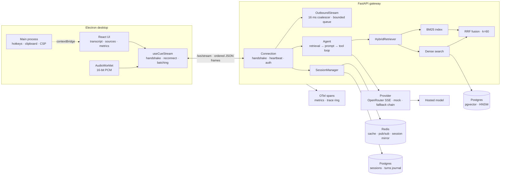
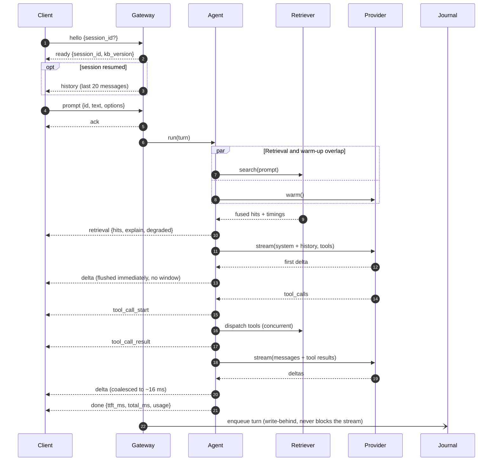

# cuePilot

[](https://github.com/Mahnoor-Zaffar/CuePilot-Real-Time-Hybrid-Autonomous-Assistant/actions/workflows/ci.yml)


[](https://github.com/Mahnoor-Zaffar/CuePilot-Real-Time-Hybrid-Autonomous-Assistant/releases/latest)
[](https://github.com/Mahnoor-Zaffar/CuePilot-Real-Time-Hybrid-Autonomous-Assistant/pkgs/container/cuepilot-real-time-hybrid-autonomous-assistant)

A real-time desktop copilot that streams grounded answers over a single full-duplex
WebSocket. Electron/React client, FastAPI gateway, hybrid **BM25 + pgvector** retrieval,
streamed tool calling, and first-class handling of backpressure, cancellation, reconnect,
and infrastructure loss.

The thesis: real-time AI is a **transport and retrieval problem** before it is a prompt
problem. Tokens arrive out of order or not at all, clients are slower than models, providers
rate-limit, caches go stale, and a socket dies mid-sentence. This repo treats those as the
product, not as edge cases.

```
74 tests · ruff clean · tsc clean · renderer 245 KiB / 76 KiB gzip
```

---

## At a glance

| | |
|---|---|
| **Transport** | One ordered `/ws/stream` socket carrying typed JSON frames, both directions |
| **Retrieval** | Parallel BM25 and dense search fused with reciprocal rank fusion (`k=60`), capped at one chunk per document |
| **Generation** | OpenRouter (OpenAI-compatible SSE) with a deterministic offline mock |
| **Tool loop** | `kb_search`, `kb_open`, `now`, `kb_stats`; validated schemas, bounded iterations |
| **Backpressure** | Server coalesces to ~16 ms frames and drops frames, never text; client batches per animation frame |
| **State** | Sessions hot in memory, mirrored to Redis, journaled to Postgres; `kb_version` invalidates retrieval caches |
| **Observability** | OTel spans plus an in-process trace ring at `/api/traces/{id}`; latency histograms at `/api/metrics` |
| **Ships as** | Multi-arch gateway image on GHCR and signed-out macOS DMGs on the releases page |
| **Runs offline** | No API key, no Docker, no model download required |

---

## Architecture



Everything is built once in the FastAPI lifespan and stored on `app.state.runtime`.
The WebSocket handler and REST routes share the same graph; nothing constructs clients
per request.

---

## A turn, end to end



Ordering is a transport guarantee, not a merge algorithm:

```
ack → retrieval? → (delta | tool_call_start | tool_call_result)* → done | aborted | error
```

The server flushes buffered text before any control or terminal frame. The client flushes
pending text before applying `done`/`error`/`aborted`/`history`. Deltas carry a monotonic
`seq` per turn. See [docs/PROTOCOL.md](docs/PROTOCOL.md) for every frame and close code.

---

## What is actually hard here

| Problem | Mechanism | Where |
|---|---|---|
| A slow client must not corrupt the answer | Coalesce deltas into ~16 ms frames; on a full queue drop the **frame** and re-queue its text | `server/app/ws/outbound.py` |
| TTFT must not pay for batching | The first delta bypasses the flush window; the client paints it immediately | `outbound.py`, `useCueStream.ts` |
| A cancel must stop the upstream bill | Cancel the turn task; the provider's `async with` closes the SSE response | `agent.py`, `connection.py` |
| Abort may land on another replica | Publish `turn.abort` on Redis pub/sub; the owning replica cancels | `runtime.py`, `bus.py` |
| Ingest must invalidate every cached result | Cache key embeds `kb_version`; ingest publishes `kb.invalidate` | `orchestrator.py`, `api/kb.py` |
| One retriever can be down | `gather(return_exceptions=True)`; fuse the survivor and report `degraded` | `orchestrator.py` |
| A mid-stream retry would duplicate text | Retries and model fallback happen **only before the first token** | `openrouter.py`, `registry.py` |
| Postgres/Redis may not exist | In-process exact-cosine store and TTL cache/bus with identical interfaces | `infra/db.py`, `infra/cache.py`, `infra/bus.py` |
| Schema and embedding width can drift | Templated SQL, advisory-locked runner; a parameter change rebuilds through a down file | `infra/migrations.py`, `app/migrations/` |

---

## Measured results

Generated by `server/bench/run_bench.py` on the machine that produced
[docs/METRICS.md](docs/METRICS.md). Retrieval is reported twice: once with the
dependency-free hash proxy (`make bench`) and once with a real semantic embedder
(`make bench-semantic` → [docs/METRICS.semantic.md](docs/METRICS.semantic.md)).
Every number is produced by running this code; none is hand-entered.

The evaluation corpus is deliberately larger and harder than the demo knowledge base:
**412 documents → 796 chunks**, including 12 hand-written hard negatives and near-miss
identifiers, queried by **100 hand-labelled queries** (30 identifier, 54 paraphrase,
16 near-miss).

| Retrieval metric (recall@5, 100 queries) | Hash proxy | Semantic (`model2vec`) |
|---|---|---|
| BM25 only | 87.0% [80–93] | 87.0% [80–93] |
| Dense only | 83.0% [76–90] | 81.0% [73–89] |
| **Hybrid (RRF, k=60)** | **87.0%** [81–93] | **88.0%** [81–94] |
| Hybrid vs. best single retriever | +0.0 pp [−5, +5] | +1.0 pp [−4, +7] |
| Hybrid vs. dense only | +4.0 pp [0, +9] | **+7.0 pp [+1, +13]** |
| Paraphrase recall (BM25 → hybrid) | 75.9% → 77.8% | 75.9% → 77.8% |
| Union recall (either single retriever answers) | 89.0% | **92.0%** |
| Fusion gap (single retriever found, hybrid lost) | 4 | 5 |
| Retrieval latency, hybrid p50 / p95 | 2.1 / 2.8 ms | 1.8 / 2.8 ms |

Brackets are 95% percentile-bootstrap intervals over the 100 labelled queries
(2,000 resamples, paired for comparisons). One query is 1 pp, so read the interval,
not the point.

| System metric | Result |
|---|---|
| Client-observed TTFT, mock provider with a fixed 120 ms first byte | p50 **~124 ms**, p95 **~130 ms** |
| Gateway overhead above the provider's first byte | p50 **~1.0 ms**, p95 **~1.4 ms** |
| Delta coalescing, 300 tokens @ ~90 tok/s | **151 frames** (−49.7%), lossless, 0 drops |
| Renderer JS heap, idle | **9.5 MB**, 137 DOM nodes |
| Renderer process working set, idle | **79.9 MB** |
| Renderer bundle | **245 KiB JS / 76 KiB gzip**, 18 KiB CSS / 4.3 KiB gzip |

### What these numbers do and do not say

- **TTFT is a gateway claim, not a model claim.** With a deterministic mock whose first byte
  is fixed at 120 ms, the client sees ~124 ms and the gateway adds ~1 ms. A hosted model's
  TTFT is provider-dependent; the defensible column is the overhead.
- **The hybrid edge over BM25 is inside the noise band; the edge over dense is not.**
  With 100 queries, 1 pp is one query. The paired bootstrap puts hybrid − BM25 at
  +1.0 pp with a 95% CI of −4 to +7 (semantic) and +0.0 pp with −5 to +5 (hash); both
  include zero. Hybrid − dense is +7.0 pp [+1, +13], which does exclude zero. So the
  defensible claim is "fusion recovers queries dense alone misses", not "hybrid beats
  BM25". The interval is part of the result, not a disclaimer.
- **The +15–25% hybrid target is not reproduced, and the reason is now measurable.**
  With a real semantic embedder hybrid beats the best single retriever by **+1.0 pp**
  (88.0% vs 87.0%), an interval that includes zero. The two retrievers are strongly
  complementary — at least one answers **92 of 100** queries — but unweighted RRF
  captures only 88, so **fusion, not coverage, is the bottleneck**. On this
  identifier-dense KB BM25 already reaches 87%, leaving 13 pp of headroom; a 15–25%
  *relative* lift is not available without a better fusion rule or a reranker. The
  measured +1.0 pp, with its interval, is reported rather than a tuned number.
- **The semantic embedder is a runtime path, not a benchmark-only stand-in.**
  `CUEPILOT_EMBEDDING_PROVIDER=local` runs `model2vec` inside the gateway. The schema
  width follows the model (`VECTOR(256)` for `potion-base-8M`), and switching back to
  the hash or hosted path rebuilds the derived table through a down migration. With
  the lexical hash proxy the hybrid is +0.0 pp over BM25; with `model2vec` it is
  +1.0 pp over BM25 and +7.0 pp over dense-only, and near-miss recall returns to 100%.
- **The expanded benchmark exposed a real retrieval bug, now fixed.** A long document
  could contribute several chunks and fill the top-5, crowding the answer out; fusion now
  caps chunks per document (`retrieval_max_chunks_per_doc`, default 1). That is a product
  fix, not a benchmark trick — returning three chunks of one document is the wrong answer.
- **Memory is the renderer JS heap, not process RSS.** The sub-50 MB target is met by the
  9.5 MB heap. Chromium's renderer working set is 79.9 MB and all Electron processes total
  ~247 MB; that baseline belongs to the runtime, not the React tree.

---

## Quickstart

Two ways in. Both run without an API key: the gateway falls back to the deterministic mock
provider and the hash embedder, and still exercises retrieval, the tool loop, and streaming.

### Try it without cloning

The gateway image is published for `linux/amd64` and `linux/arm64`:

```bash
docker run --rm -p 8000:8000 \
  ghcr.io/mahnoor-zaffar/cuepilot-real-time-hybrid-autonomous-assistant:latest
```

It boots degraded (in-process vector store, cache, bus) with no Postgres or Redis, seeds the
62-chunk knowledge base, and is ready in about two seconds:

```bash
curl -s localhost:8000/api/health | jq '.status, .kb.chunks'
# "degraded"
# 62
```

The desktop client is a signed-out macOS build on the
[releases page](https://github.com/Mahnoor-Zaffar/CuePilot-Real-Time-Hybrid-Autonomous-Assistant/releases/latest):
`cuePilot-0.1.0-arm64.dmg` for Apple Silicon, `cuePilot-0.1.0.dmg` for Intel. It is not
notarized, so the first launch needs **right-click → Open** (or
`xattr -dr com.apple.quarantine /Applications/cuePilot.app`).

### From source

Requirements: Python 3.12, [uv](https://docs.astral.sh/uv/), Node 20+. Docker is optional.

```bash
git clone https://github.com/Mahnoor-Zaffar/CuePilot-Real-Time-Hybrid-Autonomous-Assistant.git
cd CuePilot-Real-Time-Hybrid-Autonomous-Assistant

make setup            # server/.venv + desktop/node_modules + tooling, creates .env
docker compose up -d  # pgvector on 5433, Redis on 6380 (optional)
make server           # gateway on http://127.0.0.1:8000
make desktop          # Electron + Vite, second terminal
```

Ask *"What does CUE-E1042 mean?"*. The answer streams with source cards, a `kb_search` tool
chip, and per-turn TTFT. **Enter** sends, **Shift+Enter** adds a line, **Stop** cancels
mid-stream.

No Docker? The gateway starts degraded on in-process stores. No API key? It runs the
deterministic mock provider and still exercises retrieval, the tool loop, and streaming.
For a real model, set:

```bash
CUEPILOT_OPENROUTER_API_KEY=sk-or-...
CUEPILOT_LLM_MODEL=openai/gpt-4o-mini
```

The provider speaks the OpenAI chat-completions dialect, so any compatible endpoint works
via `CUEPILOT_OPENROUTER_BASE_URL`.

To build the container or the installer locally:

```bash
docker build -t cuepilot-gateway server/   # 82 MB, runs as uid 10001
cd desktop && npm run package:mac          # -> release/cuePilot-0.1.0*.dmg
```

### Configuration

Every setting is `CUEPILOT_<UPPER_SNAKE>`; the full reference is [`.env.example`](.env.example).

| Variable | Default | Purpose |
|---|---|---|
| `CUEPILOT_OPENROUTER_API_KEY` | unset | Enables the hosted provider; otherwise mock |
| `CUEPILOT_LLM_MODEL` | `openai/gpt-4o-mini` | Primary model |
| `CUEPILOT_LLM_FALLBACK_MODELS` | 2 models | Tried in order before the first token |
| `CUEPILOT_OPENAI_API_KEY` | unset | Real embeddings + Whisper transcription |
| `CUEPILOT_EMBEDDING_PROVIDER` | `auto` | `auto` \| `openai` \| `hash` \| `local` (`local` = offline `model2vec`) |
| `CUEPILOT_LOCAL_EMBEDDING_MODEL` | `minishlab/potion-base-8M` | Static model for the `local` provider |
| `CUEPILOT_DATABASE_URL` | `…@127.0.0.1:5433/cuepilot` | pgvector store; migrated on boot |
| `CUEPILOT_REDIS_URL` | `redis://127.0.0.1:6380/0` | Cache, pub/sub, session mirror |
| `CUEPILOT_SESSION_JOURNAL_ENABLED` | `true` | Write sessions and turns through to Postgres |
| `CUEPILOT_SESSION_JOURNAL_QUEUE` | `256` | Bounded write-behind queue; full means dropped writes, never a stalled stream |
| `CUEPILOT_SESSION_JOURNAL_DRAIN_S` | `3.0` | Graceful-shutdown drain budget for the journal worker |
| `CUEPILOT_ALLOW_DEGRADED_INFRA` | `true` | Fall back instead of failing startup |
| `CUEPILOT_OTEL_EXPORTER` | `none` | `none` \| `console` \| `otlp` |

The schema is owned by `server/app/migrations/` and applied on boot under a Postgres
advisory lock, so replicas can start together. Each file records only the parameters it
declares, so a parameter change — today, the embedding width — rebuilds just the file that
owns it: the runner applies the matching `.down.sql`, re-runs the file, and bumps
`kb_meta.version` so cached results keyed on the old vectors are dropped. A migration that
alters objects from an earlier one declares that with a `-- requires: 001` header, and a
rebuild cascades only through that declared graph. The journal (`002`) declares neither, so
an embedding-width rebuild leaves the turn history intact. Run it as its own step with
`make migrate`. Editing an already-applied file fails startup by design.

---

## Quality gates

```bash
make check        # ruff + tsc (renderer and electron) + 123 tests + docs gate
make test-local   # real semantic embedder tests (needs: cd server && uv sync --extra local)
make migrate      # apply SQL migrations without booting the gateway
make bench        # regenerate docs/metrics.json and docs/METRICS.md
make measure-idle # desktop idle footprint -> desktop/bench/idle.json
make metrics      # measure-idle, then bench
```

`make check` runs the same steps as CI. The workflow in
[`.github/workflows/ci.yml`](.github/workflows/ci.yml) fans them out: the server suite on
Python 3.11 and 3.12 against the locked `uv.lock`, a migration job against a real
`pgvector` service (apply, idempotent re-run, dimension rebuild, two replicas racing, a
journal round-trip and a transcript surviving an embedding-width rebuild),
a job that installs the `local` extra and exercises the real semantic embedder, the
renderer typecheck and production build on Node 22, and a docs gate that parses every
Mermaid diagram and resolves every relative link. `scripts/check-docs.mjs` uses mermaid's
own grammar under jsdom, so a broken diagram fails the build instead of shipping as a
broken image.

[`.github/workflows/release.yml`](.github/workflows/release.yml) gates both artefacts on the
test suite, then publishes the multi-arch image to GHCR and cross-builds both DMGs on
`macos-15`. Pushing a `v*` tag turns that run into a GitHub Release with the installers
attached — `v0.1.0` is the current one.

Tests are hermetic: they point Postgres and Redis at `127.0.0.1:1`, so every fallback path
runs on every invocation and health correctly reports `degraded`.

| Area | Coverage |
|---|---|
| Protocol | Frame parsing, defaults, invalid input, server frame builders |
| Streaming | Coalescing is lossless; control frames ordered before `done`; full queue drops frames not text |
| Retrieval | Exact-identifier ranking, fused provenance, cache invalidation on version bump, single-retriever degradation |
| Agent | Tool loop, history append, rate-limit error frame, no retry after first token, cancellation |
| WebSocket | Handshake, abort, reconnect + history replay, unknown session, bad frame, audio ack, auth |
| Journal | Queue drops under pressure, write retry/failure counters, cache-miss recovery, Postgres round-trip, orphan turn insert |
| API | Health, search, ingest + invalidation, metrics/traces after a turn |

---

## Failure model

Handled explicitly, with detection and recovery documented per case:

| Failure | Behavior |
|---|---|
| Gateway unreachable | Full-jitter reconnect: `max(250 ms, rand · min(8 s, 250 · 2ⁿ))`, 8 attempts |
| Server restart mid-turn | Reconnect, resume session, replay last 20 messages |
| Provider 429 / 5xx | Retry with backoff → pre-token model fallback → typed retryable error |
| Provider dies after first token | No retry; terminal error, partial answer preserved |
| Tool timeout / bad args | Error result fed to the model; turn continues |
| One retriever down | Fuse the survivor; `degraded` surfaced in frame and UI |
| Postgres / Redis absent | In-memory store / cache / bus; health reports degraded. Sessions stay mirror-only and `journal.backend` is `none` |
| Journal queue full | Drop the write and count it (`journal.dropped`); the stream never blocks on durability |
| Postgres lost mid-session | Redis still serves the hot session; resume falls back to a new session only once both are gone |
| Slow client | Drop delta frames, re-queue text; control frames wait |
| Silent client | Heartbeat timeout closes `4408`; client reconnects |

Full matrix, including stale-context invalidation and audio failures:
[docs/FAILURE_MODES.md](docs/FAILURE_MODES.md).

---

## Repository layout

```
server/
  app/
    ws/           protocol · connection lifecycle · coalescing writer · sessions · journal · audio
    llm/          provider interface · OpenRouter SSE · mock · fallback chain · agent · tools
    retrieval/    tokenizer · BM25 · embedder (hash/http/local) · chunking · RRF · orchestrator
    infra/        cache · event bus · pgvector / memory store · migration runner
    migrations/   numbered SQL up/down files (schema lives here)
    telemetry/    metrics registry · OTel spans · in-memory trace ring
    api/          health · KB ingest/search/stats · metrics · traces
  bench/          reproducible harness · 100 labelled queries · bootstrap stats
  scripts/        migrate.py (apply schema without booting)
  tests/          123 tests
  Dockerfile      multi-stage image, 82 MB, unprivileged, healthchecked
desktop/
  src/            React UI + useCueStream (the entire client transport)
  electron/       main process (hotkeys, clipboard, CSP) + contextBridge preload
  scripts/        measure-idle.cjs
docs/             architecture · protocol · failure modes · generated metrics
scripts/          check-docs.mjs (mermaid + link gate)
.github/          CI (server matrix · migrations · local embedder · desktop · docs) and release
```

---

## Design decisions

**One socket, many frame types.** A single ordered channel makes text/tool/terminal ordering
a property of the transport. Separate channels need a merge protocol and still race.

**Coalesce on both ends, fast-path the first token.** The server caps outbound frames near
60/s; the client paints once per animation frame. Both bypass batching for the first delta so
TTFT is not an artifact of the batching strategy.

**Drop frames, not tokens.** A full send queue sheds a delta frame and re-queues its text.
Only a wedged client at the 64k buffer cap loses characters, and that is counted.

**Never retry after the first token.** Mid-stream retry duplicates text. Retries and model
fallback are strictly pre-output.

**Version the cache, not the process.** `kb_version` in the key makes ingest self-invalidating;
`kb.invalidate` rebuilds other replicas' BM25 indexes. No flush-all, no stale reads.

**Degrade loudly.** Health, `/api/metrics`, `retrieval.degraded`, and the UI all name the
fallback backend. A degraded system that looks healthy is worse than an outage.

**RRF over a cross-encoder.** No training, no second forward pass, invariant to BM25/cosine
score scales; one O(n) pass over the candidate pool. The benchmark shows the remaining
precision is a *fusion* problem, not a coverage one: the two retrievers jointly answer 92%
of queries, but unweighted RRF captures 88%. A weighted fusion or a reranker is the next
lever, not the first.

**One chunk per document in the fused window.** A long document is split into several
chunks, and without a cap a single document can fill the top-k and crowd out the answer.
The cap is applied after ranking and before truncation, so relevance order is unchanged.

### At 100× the load

Move lexical search into Postgres (`tsvector`/`pg_trgm`) or OpenSearch so replicas stop
building private BM25 indexes. Replace the O(n) memory fallback with the real ANN path only.
Partition the turn journal by session and age, and stream it to an analytics sink instead
of reading it back one session at a time. Aggregate metrics per worker instead of scraping a
single process. Add a reranker and per-client rate limits. Concurrent turns per session would
need per-turn outbound queues and an explicit merge policy — the current single-active-turn
rule is a deliberate simplification.

---

## Limitations

**Not built yet** — the next slices:

- The desktop app is a **client skeleton**: shell, streaming transport, and UI are complete;
  system-audio capture is stubbed in the main process (microphone capture is real).
  Packaging and notarization are not wired up.
- The benchmark corpus is synthetic. The bootstrap intervals say how much of a difference
  this label set can resolve; they say nothing about your domain. A BEIR subset would add
  an external reference point.

**Test doubles, kept on purpose:**

- `MockProvider` is a deterministic double. It exists so the suite and the offline demo are
  reproducible; it is not a model. The semantic path itself is real:
  `CUEPILOT_EMBEDDING_PROVIDER=local` runs `model2vec` in the gateway, and `HttpEmbedder`
  runs hosted embeddings when a key is set. Both are exercised in CI.
- The hash embedder remains the zero-dependency default. It is a lexical proxy, labelled as
  such everywhere, and never presented as a semantic encoder.

---

## Reading order

1. [docs/ARCHITECTURE.md](docs/ARCHITECTURE.md) — components, turn lifecycle, retrieval, tradeoffs
2. [docs/PROTOCOL.md](docs/PROTOCOL.md) — every frame, ordering guarantees, close codes
3. [docs/FAILURE_MODES.md](docs/FAILURE_MODES.md) — what breaks, how it is detected, what happens
4. [docs/METRICS.md](docs/METRICS.md) — generated benchmark report

For a 10-minute review: `server/app/ws/outbound.py`, `server/app/llm/agent.py`,
`server/app/retrieval/orchestrator.py`, then `desktop/src/useCueStream.ts`.
